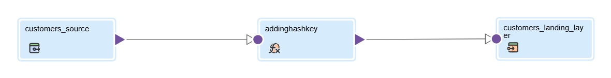
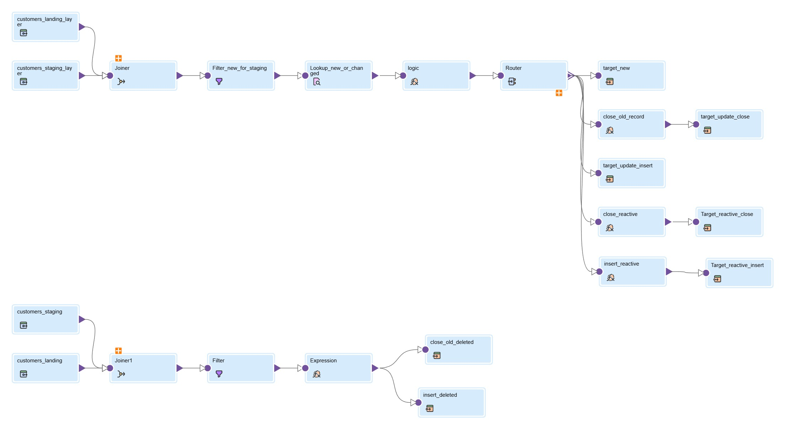
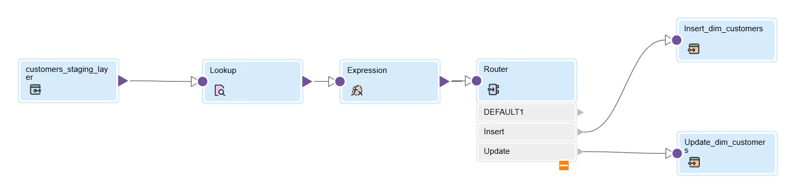

# Customer Data Warehouse — SCD Type 2 with Informatica Cloud

## Project Overview

I built this customer ETL pipeline using **Informatica Cloud Data Integration (CDI)** and **SQL Server**, focusing on how to maintain customer history using **Slowly Changing Dimension (SCD) Type 2**.

The pipeline processes customer data from a CSV file through three layers: Landing, Staging, and a Customer Dimension.

The main goal was to handle different changes in customer data without losing previous records. This includes new customers, changes to existing customer information, customers disappearing from the source, and customers returning after being marked as deleted.

One of the most important things I learned while building this project was the difference between **detecting changes in customer data** and **synchronizing historical versions into a dimension**.

## Technologies Used

- **ETL:** Informatica Cloud Data Integration (CDI)
- **Database:** Microsoft SQL Server
- **Data Source:** CSV
- **Data Warehousing:** Dimensional Modeling, SCD Type 2, Surrogate Keys
- **Transformations:** Expression, Joiner, Lookup, Filter, Router
- **Orchestration:** Informatica Taskflow

## Pipeline Architecture

```text
                 Customer CSV
               (Full Snapshot)
                       |
                       v
           landing_layer.Customer
           ----------------------
           Latest customer data
           Hash_Key generation
                       |
                       v
           staging_layer.Customers
           ----------------------
           Change detection
           SCD Type 2 history
           Deletion & Reactivation
                       |
                       v
           dwh_layer.Dim_Customers
           ----------------------
           Historical versions
           INSERT / UPDATE / SKIP
```

The pipeline is divided into three mappings, each with a different responsibility.

## Design Decision: Why Maintain History in STAGING?

In this implementation, I maintained the **SCD Type 2 history in the Staging layer**, rather than creating it directly in the final Customer Dimension.

The reasoning behind this design is to keep the historical customer records independent of the final Data Warehouse structure.

For example, if the dimension schema needs to change, or a different Data Warehouse design is introduced later, the historical versions stored in STAGING can be reused without relying only on the latest customer snapshot.

This also means that STAGING is not treated as a temporary table that gets cleared after every run. Its historical records need to be preserved.

I understand that SCD Type 2 can also be implemented directly in a Dimension table. This project follows a design where **STAGING manages the history, and the Dimension synchronizes it**.

---

## Mapping 1: Source → Landing

**Mapping:** `customers_source_to_landing`



The first mapping loads customer data from a CSV file into `landing_layer.Customer`.

Most of the incoming customer attributes are loaded directly. The main transformation is an **Expression** that generates a `Hash_Key` using MD5, based on the customer ID, name, city, country, and status.

### Why use a Hash Key?

I use the hash to help detect whether the customer data has changed between source snapshots.

Instead of comparing the individual customer attributes separately in the next mapping, the hash provides one value representing the monitored data.

The hash is used for change comparison, while `Customer_ID` remains the business identifier.

### Why truncate LANDING?

The Mapping Task is configured to **Truncate Target** before loading the CSV.

The purpose is to keep LANDING as a representation of the latest source snapshot, rather than accumulating records from previous runs.

This decision depends on an important assumption: **each source file contains the complete customer snapshot**.

If the file contains only part of the customer data, a missing customer could incorrectly be treated as deleted in the next mapping.

---

## Mapping 2: Landing → Staging

**Mapping:** `customers_landing_to_staging`



This mapping is responsible for maintaining the SCD Type 2 history in `staging_layer.Customers`.

During the initial load, customer records are inserted into the empty staging table.

In later runs, the mapping identifies which customers are new, changed, deleted, or reactivated, and updates the historical versions accordingly.

### Part 1: Detecting New, Changed, and Reactivated Customers

**Step 1 — Joiner on Hash_Key**

The mapping starts by comparing LANDING with STAGING using `Hash_Key`.

The Joiner preserves the LANDING rows, while the STAGING source is filtered to:

```sql
Is_Current = 1 AND Is_Deleted = 0
```

This means the comparison is against current, non-deleted customer versions.

If a matching hash is found, the customer data being compared is already represented by an active version.

If no match is found, the STAGING fields from the Joiner are NULL.

**Step 2 — Filter unmatched records**

The next Filter uses:

```sql
ISNULL(stg_Stage_SK)
```

This allows records without a matching active hash to continue.

An important distinction here is that **a missing hash match does not automatically mean a new customer**.

The customer might be new, an existing customer whose attributes changed, or a previously deleted customer returning to the source.

**Step 3 — Lookup on Customer_ID**

To distinguish between those cases, I use a Lookup on STAGING based on `Customer_ID`.

The Lookup considers records with:

```sql
Is_Current = 1
```

Unlike the earlier Joiner, it does not exclude deleted versions.

The returned fields include:

`Stage_SK`, `Customer_ID`, and `Is_Deleted`.

The Lookup helps identify whether the customer already exists and whether their current historical state is deleted.

**Step 4 — Expression and Router**

An Expression classifies the incoming record, and a Router directs it to the appropriate target operations.

| Scenario | Action |
|---|---|
| New | Insert the customer's first version |
| Changed | Close the previous version and insert a new active version |
| Reactive | Close the previously deleted version and insert a new active version |

For a changed customer, the previous record is closed by setting `Is_Current = 0` and recording `End_Date`. A new version is inserted with the updated attributes, a new `Stage_SK`, and `Is_Current = 1`.

The same close-and-insert pattern applies to reactivation, except the version being closed represents the customer's deleted state.

### Part 2: Handling Deleted Customers

Deletion detection uses a separate branch within the same mapping.

This time, the Joiner preserves the current, non-deleted STAGING records and compares them with LANDING using `Customer_ID`.

The Filter checks:

```sql
ISNULL(lnd_Customer_ID)
```

If a current staging customer is missing from the complete LANDING snapshot, the mapping treats that customer as deleted.

Two operations are performed:

**UPDATE:** Close the previous active version by setting `Is_Current = 0` and recording `End_Date`.

**INSERT:** Create a new historical version using the customer's last known attributes, with:

```sql
Is_Current = 1
Is_Deleted = 1
End_Date   = NULL
```

I used this approach to preserve the deletion in customer history instead of physically removing previous records.

### A Key Detail I Learned While Debugging Reactivation

During testing, I encountered an issue where the previous deleted version remained current even after a new active version was inserted.

The session log showed an UPDATE request, but no rows were affected.

After checking the mapping, I found that the Reactivation Close target was using `stg_Stage_SK` from the hash Joiner instead of `lkup_Stage_SK` from the customer Lookup.

This distinction matters because the Joiner excludes deleted versions. For a reactivated customer, its `Stage_SK` can therefore be NULL in the Joiner output.

The Lookup, however, can still find the current deleted version because it only filters on `Is_Current = 1`.

Using `lkup_Stage_SK` allows the UPDATE to identify the correct historical record.

This was a useful reminder to check the **actual rows affected and the target field mappings**, rather than relying only on the mapping's validation status.

---

## Mapping 3: Staging → Customer Dimension

**Mapping:** `customers_staging_to_customersdim`



This mapping synchronizes the historical records from STAGING into `dwh_layer.Dim_Customers`.

The main difference from the previous mapping is that **the historical versions have already been created in STAGING**.

At this stage, the goal is not to detect changes in the original CSV again. Instead, each staging version is checked to determine whether it needs to be inserted, updated, or skipped in the Dimension.

### Why use Stage_SK in the Lookup?

The Lookup compares:

```sql
STAGING.Stage_SK = DIM.Stage_SK
```

I used `Stage_SK` because it identifies a specific historical version of a customer.

`Customer_ID` identifies the customer across all their versions, so matching on it alone would not tell us whether a particular historical version had already been loaded.

`Customer_SK`, on the other hand, is generated inside the Dimension. It identifies the corresponding dimension record but is not available as an incoming key from STAGING.

### Lookup Return Fields

The Lookup returns:

- `Customer_SK`
- `Is_Current`
- `End_Date`

`Customer_SK` tells us whether the staging version already exists in the Dimension and identifies it for an UPDATE.

`Is_Current` and `End_Date` are used to compare the Dimension's existing values against the values in STAGING.

### Expression and Router Logic

The Expression assigns one of three actions:

| Action | Condition | Result |
|---|---|---|
| Insert | The staging version does not exist in DIM | Insert a new dimension row |
| Update | The version exists, but its current flag or end date differs | Update the existing dimension row |
| Skip | The version exists and the checked values match | No target write |

The Router directs Insert and Update records to their respective targets.

Skip records do not need a separate target.

For UPDATE operations, the mapping uses `Customer_SK` returned from the Lookup to identify the dimension record. The updated `Is_Current` and `End_Date` values come from STAGING, since STAGING holds the history being synchronized.

### Why doesn't UPDATE also require INSERT here?

This was one of the main differences I wanted to understand.

In Landing → Staging, a single changed customer record can trigger two operations: closing the old version and inserting a new one.

In Staging → Dimension, those two versions already exist as separate staging records.

The old version can require an UPDATE in DIM, while the new version independently requires an INSERT.

If the Dimension were completely empty, both versions would simply be inserted.

This is why **Mapping 2 maintains the history, while Mapping 3 synchronizes that history**.

The mapping includes historical and deleted versions rather than filtering the source to current, non-deleted records only.

---

## Validation and Testing

I tested the pipeline using SQL Server queries to inspect the records created in LANDING, STAGING, and the Customer Dimension.

A clean initial load confirmed that customer records reached the Dimension with their generated surrogate keys and SCD tracking fields.

The project also included troubleshooting of insertion failures and the Reactivation Close target.

The initial load has been observed successfully, but the full set of change, deletion, and reactivation scenarios still requires controlled end-to-end verification after the fixes.

### Current Technical Considerations

There are a few details I want to validate further:

- **NULL handling:** The Staging-to-Dimension Expression compares `End_Date` values. Because an end date can be NULL, the comparison needs to handle NULL explicitly to avoid missing an update.
- **Historical consistency:** Each customer should have only one `Is_Current = 1` version at any point.
- **Partial failures:** Closing an old version and inserting a new one should not leave incomplete history if one operation fails.
- **Attribute synchronization:** The current Dimension update decision mainly checks `Is_Current` and `End_Date`; additional attribute corrections may require extending that logic.

These are important checks before treating the pipeline as a fully validated incremental-loading solution.

SQL validation queries are available in [`sql/validation_queries.sql`](sql/validation_queries.sql).

---

## Repository Structure

```text
Customer-DWH-SCD2-Informatica/
│
├── README.md
│
├── informatica/
│   ├── mapping-diagrams/
│   │   ├── customers_source_to_landing.jpg
│   │   ├── customers_landing_to_staging.jpg
│   │   └── customers_staging_to_customersdim.jpg
│   │
│   └── mapping-specifications/
│       └── asset-notes.md
│
└── sql/
    └── validation_queries.sql
```

The mapping diagrams and specifications were prepared from my Informatica project export.

The original Informatica export is kept separately because it contains environment-specific connection references. The diagrams and notes document the implementation but are not importable mapping assets.

## Final Takeaway

The most valuable part of this project for me was understanding **why each transformation was needed**, not just how to connect them in Informatica.

The Hash Joiner helps identify differences in the incoming data, the Customer Lookup determines the appropriate historical action, and the final Dimension Lookup checks whether each existing version needs synchronization.

Working through these mappings and debugging their results helped me better understand SCD Type 2, surrogate keys, incremental loading, and the difference between maintaining history and loading a Data Warehouse dimension.
